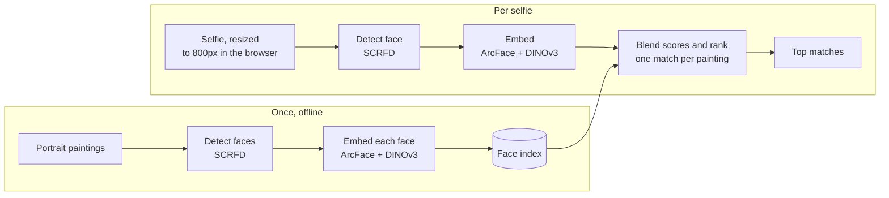

# Historical Twin

**Take a selfie and meet the portrait painting that looks the most like you.**

👉 **Try it at [twin.maxaltman.com](https://twin.maxaltman.com)**

Historical Twin compares your face with about 19,000 faces in some 17,000 portrait paintings,
from Renaissance altarpieces to 20th-century presidential portraits, and shows you your
closest matches, each with its artist, title and year where those are known.

## Using it

1. Open [twin.maxaltman.com](https://twin.maxaltman.com) on your phone or computer.
2. Take a selfie with the camera, or upload a photo.
3. See your best match: the painted face, the whole painting and its caption. Tap the runners-up
   to switch between them, and, for museum works, follow the link to the museum's page.
4. Share a card with your face next to your painted twin's, or download it.

Good light and a face looking roughly at the camera give the best matches.

### Privacy

Your photo is processed in memory to find your matches and then discarded. It is never saved,
logged or used for training, and neither is the face data computed from it. The share card is
drawn in your browser, so your selfie isn't uploaded a second time.

## How it works



Every face in the collection is found and embedded ahead of time. When you upload a selfie,
the server runs the same pipeline on it and compares it with every painted face. At this
scale, a brute-force comparison in NumPy takes a few milliseconds, so no vector database
is needed. Nothing is trained: all of the models are pretrained.

### Two kinds of likeness

A match is scored on two things.

- **Identity** comes from [ArcFace](https://github.com/deepinsight/insightface) (InsightFace
  `buffalo_l`), a face-recognition model. It's good at telling whether two faces belong to the
  same person, so it will find a painting of you if one exists. On its own it tends to ignore
  hair, coloring, age and pose, which are much of what makes a portrait feel like you.
- **Appearance** comes from [DINOv3](https://github.com/facebookresearch/dinov3), a general
  vision model, applied to a crop of the face. It captures that overall look.

The two scores are normalized per query and blended, 30% identity and 70% appearance. The
weights were chosen in blind side-by-side reviews: for each of 28 test photos, reviewers
picked the best results without knowing which method produced them. Results that used an
appearance model were preferred about 2 to 1 over ArcFace alone, and a second review chose
DINOv3 over its predecessor, DINOv2.

### The collection

- **WikiArt portraits:** about 14,000 paintings from the
  [wikiart-portraits](https://huggingface.co/datasets/mixitymax/wikiart-portraits) dataset.
  The dataset has no artist or title metadata, so each painting is looked up by perceptual
  hash in the [ArtGAN WikiArt](https://www.kaggle.com/datasets/steubk/wikiart) dataset. About
  71% are identified; the rest are shown without a caption rather than with a wrong one.
- **Museum collections:** about 3,400 public-domain (CC0) portraits from
  [The Metropolitan Museum of Art](https://www.metmuseum.org/), the Smithsonian's
  [National Portrait Gallery](https://npg.si.edu/) and the
  [Smithsonian American Art Museum](https://americanart.si.edu/), each linked to the museum's
  page for that work. Paintings already in the WikiArt set are skipped.

Most of the collection is European and American painting, so people of other backgrounds,
especially Black and East Asian people, have far fewer close matches. That's a gap in the
collection rather than in the matching, and adding portraits from more traditions is the
most useful thing that could happen next.

## Architecture

| Part | What it is | Where it runs |
|---|---|---|
| Website ([`frontend/`](frontend/)) | Next.js static site with the camera, results and share card | Netlify |
| API ([`backend/`](backend/)) | FastAPI service with a `/match` endpoint; also serves painting thumbnails and face crops | Google Cloud Run, scaling to zero when idle |
| Face pipeline ([`src/paintmatch/`](src/paintmatch/)) | Shared decode → detect → embed code, used by both the indexer and the API so paintings and selfies are processed identically | inside the API |
| Indexer ([`indexing/`](indexing/)) | Downloads the paintings, builds the face index, adds metadata and museum works | offline, on a laptop |
| Assets | Face index, metadata, thumbnails and crops | a [Hugging Face dataset](https://huggingface.co/datasets/mixitymax/historicaltwin-assets), baked into the API image at build time |

The first match after a quiet period can take 10–20 seconds while a server instance starts.
After that, a match takes about a second.

## Running it yourself

You need [uv](https://docs.astral.sh/uv/) and, for the website, Node.js.

```bash
uv sync
uv run indexing/build_index.py --limit 200   # index a small sample of paintings
uv run uvicorn backend.app:app --reload      # API and a simple test page at localhost:8000
```

[DEVELOPMENT.md](DEVELOPMENT.md) covers building the full index, adding museum works and
metadata, reviewing match quality and deploying. [frontend/README.md](frontend/README.md)
covers the website.

## Licenses and credits

- InsightFace's pretrained `buffalo_l` models are licensed for **non-commercial research
  only**, and so is the ArtGAN WikiArt dataset used for captions. Historical Twin is a
  non-commercial project.
- DINOv3 is used under Meta's [DINOv3 License](https://github.com/facebookresearch/dinov3/blob/main/LICENSE.md).
- Museum images are CC0, courtesy of The Metropolitan Museum of Art and the Smithsonian
  Institution's [Open Access](https://www.si.edu/openaccess) program.
